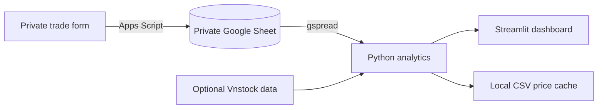

# Vietnam Equity Research Toolkit

A personal research workspace for Vietnamese equities. It combines a Google Sheets journal, a Python analytics layer, and a Streamlit dashboard for trade review, watchlists, fundamentals, screening, and portfolio risk.

> **Privacy:** this repository is designed to use a private Google Sheet. Never commit `.env`, service-account JSON, Streamlit secrets, or the local web-form configuration. Do not publish a build connected to your personal trades. Use fictional data for a public demo.

## What it contains

| Area | Purpose | Current data source |
|---|---|---|
| Trading Journal | Positions, weighted-average cost, realized P&L and trade statistics | Private `Trades` sheet |
| Watchlist | Prices, period returns, volume context and alert thresholds | `Watchlist` sheet + optional Vnstock |
| Fundamentals | Statement trends, profitability ratios and DuPont | Canonical rows in `Fundamentals` sheet |
| Screener | Criteria filters and percentile factor ranking | `Screener_Data` sheet |
| Backtest & Risk | MA/RSI research, portfolio optimization and VaR/CVaR | Historical prices + journal positions |

## Architecture



The form sends a trade to an Apps Script web app. Python reads the Sheet using a service account, computes metrics, and renders them in Streamlit. Vnstock is loaded only when market-price features are used, so the journal can run without it.

## Run locally

Use Python 3.10 or newer. From the repository root:

```powershell
py -3 -m venv .venv
.\.venv\Scripts\python.exe -m pip install -r requirements.txt
Copy-Item .env.example .env
```

Fill `.env` locally with `GOOGLE_SHEETS_SPREADSHEET_ID` and the appropriate credentials path. Put the service-account file at `credentials/service-account.json`, share the private Sheet with its `client_email`, and keep both files out of Git. The form's local URL and token are kept in the ignored `web_form/config.local.js` file.

Check the Sheet connection without printing trade rows:

```powershell
.\.venv\Scripts\python.exe -m src.sheets
```

Start the dashboard on this computer only:

```powershell
.\.venv\Scripts\python.exe -m streamlit run app/main.py --server.address 127.0.0.1
```

Open `http://127.0.0.1:8501`. Localhost binding keeps the app off the network.

## Tests

Run the hand-calculated example suite:

```powershell
.\.venv\Scripts\python.exe -m unittest discover -s tests -v
```

The tests use fictional trades and prices. They do not call Google Sheets or a market-data provider.
The 10-trade hand calculation and expected results are in [`docs/sample_calculation.md`](docs/sample_calculation.md).

## Methodology and assumptions

- **Trading cost basis:** weighted-average cost per ticker. Buy fees are added to cost basis; sell fees are deducted from proceeds. A sell above the open quantity is rejected.
- **Realized trade statistics:** sell events are treated as closed-trade observations. This can split one investment thesis across several partial sells; it is not FIFO lot accounting.
- **DuPont:** net margin × revenue / average assets × average assets / average equity. Beginning and ending balances are needed for average assets and equity. Source statement rows must be mapped and checked before being treated as VAS measures.
- **Screener ranks:** factors are converted to within-universe percentile ranks. Lower P/E, P/B and debt/equity are better; higher ROE, growth and momentum are better. Percentiles are not valuations and depend on the selected universe.
- **Backtest:** signals from day *t* are executed at the next available close, with configurable fee and slippage. Lot size, price limits, and T+2 settlement are approximations; corporate actions, taxes by broker, liquidity, auction mechanics and index reinvestment are not fully modeled. Results are research illustrations, not forecasts.
- **Risk:** VaR/CVaR depend on the chosen return window and distribution method. Markowitz weights are sensitive to estimated returns and covariances.
- **Data:** Vnstock APIs, access terms, schemas and source availability can change. Review the provider's current license and verify raw prices/statements before making decisions. Financial statement mapping is intentionally not guessed by the app.

## Google Sheets tabs

`Trades`, `Watchlist`, `Fundamentals`, `Prices_Cache`, `Screener_Data`, and `Saved_Filters` are expected by the pages that use them. The journal's `Trades` columns are `trade_id, timestamp, trade_date, ticker, side, price, quantity, fee, reason, stop_loss, target, strategy_tag`.

## Deployment and public demos

The local app is ready for private use. A public Streamlit deployment must use a separate demo Sheet filled only with fictional data; never give a public app credentials to the personal Sheet. Streamlit Community Cloud accepts app secrets in its settings, but this does not make a private dataset safe to expose through a public app. Keep the repository private if it contains any non-demo data or configuration.

The static form token is present in the browser when a form is served, so it must be treated as public. The local form configuration is ignored by Git. For a public form, add a real access-control layer (for example, authenticated users and server-side authorization) before pointing it at any private Sheet; a token embedded in HTML is not authentication.

## Project status

Core analytics and dashboard pages are implemented. Market data and fundamentals require provider access and verified source-to-canonical mappings; automated collection and public deployment remain environment-dependent. The tests validate calculations against fictional examples, not live provider data.
