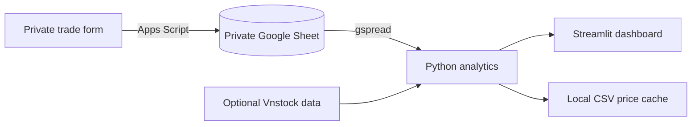

# Vietnam Equity Research Toolkit

A personal research workspace for Vietnamese equities. It combines a Google Sheets journal, a Python analytics layer, and a Streamlit dashboard for trade review, watchlists, fundamentals, screening, and portfolio risk.

> **Privacy:** this repository is designed to use a private Google Sheet. Never commit `.env`, service-account JSON, Streamlit secrets, or the local web-form configuration. Do not publish a build connected to your personal trades. Use fictional data for a public demo.

See the [repository security review](docs/security-review.md) for the latest scoped scan and its limitations.

## What it contains

| Area | Purpose | Current data source |
|---|---|---|
| Trading Journal | Positions, weighted-average cost, realized P&L and trade statistics | Private `Trades` sheet |
| Watchlist | Prices, period returns, volume context and alert thresholds | `Watchlist` sheet + optional Vnstock |
| Fundamentals | Statement trends, profitability ratios and DuPont | Canonical rows in `Fundamentals` sheet |
| Screener | Criteria filters and percentile factor ranking | `Screener_Data` sheet |
| Backtest & Risk | MA/RSI research, portfolio optimization and VaR/CVaR | Historical prices + journal positions |

## Architecture



The private trade form is served by Apps Script HTML Service and calls server functions with `google.script.run`; access can stay limited to the deploying Google account without embedding a token in the form. Python reads the Sheet using a service account, computes metrics, and renders them in Streamlit. Vnstock is loaded only when market-price features are used, so the journal can run without it.

## Run locally

Use Python 3.10 or newer. From the repository root:

```powershell
py -3 -m venv .venv
.\.venv\Scripts\python.exe -m pip install -r requirements.txt
Copy-Item .env.example .env
```

Fill `.env` locally with `GOOGLE_SHEETS_SPREADSHEET_ID` and the appropriate credentials path. Put the service-account file at `credentials/service-account.json`, share the private Sheet with its `client_email`, and keep both files out of Git. For the private form, open the Apps Script web-app `/exec` URL after deploying `apps_script/Code.gs` and `apps_script/Index.html`; the separate local HTML form configuration is ignored by Git.

Check the Sheet connection without printing trade rows:

```powershell
.\.venv\Scripts\python.exe -m src.sheets
```

Start the dashboard on this computer only:

```powershell
.\.venv\Scripts\python.exe -m streamlit run app/main.py --server.address 127.0.0.1
```

Open `http://127.0.0.1:8501`. Localhost binding keeps the app off the network.

## Tests

Run the hand-calculated example suite:

```powershell
.\.venv\Scripts\python.exe -m unittest discover -s tests -v
node tests/apps_script_smoke.js
```

Python tests use fictional trades and prices. The Apps Script smoke suite uses in-memory Google-service fakes; neither suite calls Google Sheets or a market-data provider.
The 10-trade hand calculation and expected results are in [`docs/sample_calculation.md`](docs/sample_calculation.md).
GitHub Actions runs the Python suite, syntax check, and Apps Script smoke suite on pushes and pull requests to `main`.

## Methodology and assumptions

- **Trading cost basis:** weighted-average cost per ticker. Buy fees are added to cost basis; sell fees are deducted from proceeds. A sell above the open quantity is rejected.
- **Realized trade statistics:** sell events are treated as closed-trade observations. This can split one investment thesis across several partial sells; it is not FIFO lot accounting.
- **DuPont:** net margin × revenue / average assets × average assets / average equity. Beginning and ending balances are needed for average assets and equity. Source statement rows must be mapped and checked before being treated as VAS measures.
- **Quarterly fundamentals:** Vnstock v6 documents selecting `period="quarter"`, but its current Fundamental documentation does not specify whether each income-statement and cash-flow value is a standalone quarter or year-to-date cumulative value for every source. The app therefore preserves provider values and does not subtract adjacent quarters automatically. Review raw rows against the original company filing before using quarter-over-quarter trends or the CFO/net-income cash-conversion ratio. See the [Vnstock v6 Fundamental documentation](https://www.vnstocks.com/docs/vnstock/v6/bao-cao-tai-chinh-fundamental).
- **Bank ratios:** NIM = TTM net interest income / average interest-earning assets; CIR = absolute operating expenses / operating income; NPL = groups 3–5 loans / gross customer loans; analytical LDR = gross customer loans / customer deposits; CASA = demand deposits + margin/escrow + dedicated capital, divided by customer deposits; provision-to-loans = absolute TTM credit-loss provisions / average gross loans. Note data and raw statement values must be reviewed by the user. Missing inputs stay blank. Analytical LDR is not the regulatory ratio.
- **Screener ranks:** factors are converted to within-universe percentile ranks. Lower P/E, P/B and debt/equity are better; higher ROE, growth and momentum are better. Percentiles are not valuations and depend on the selected universe.
- **Backtest:** signals from day *t* are executed at the next available close, with configurable fee and slippage. Lot size, price limits, and T+2 settlement are approximations; corporate actions, taxes by broker, liquidity, auction mechanics and index reinvestment are not fully modeled. Results are research illustrations, not forecasts.
- **Risk:** VaR/CVaR depend on the chosen return window and distribution method. Markowitz weights are sensitive to estimated returns and covariances.
- **Data:** Vnstock APIs, access terms, schemas and source availability can change. Review the provider's current license and verify raw prices/statements before making decisions. Financial statement mapping is intentionally not guessed by the app.

## Google Sheets tabs

`Trades`, `Watchlist`, `Fundamentals`, `Bank_Fundamentals`, `Prices_Cache`, `Screener_Data`, and `Saved_Filters` are used by the pages that need them. On 2026-11-10, the six non-journal tabs were initialized with their expected header rows in the connected private Sheet; they contain no sample ticker or valuation rows. Add your own symbols to `Watchlist`; `Prices_Cache` is populated only after its scheduled workflow is configured. `Screener_Data` currently expects normalized input rows and is not populated automatically. `Bank_Fundamentals` appends reviewed bank-ratio calculations. The journal's `Trades` columns are `trade_id, timestamp, trade_date, ticker, side, price, quantity, fee, reason, stop_loss, target, strategy_tag`.

## Scheduled price cache updates

`.github/workflows/update_data.yml` is scheduled for 17:30 Vietnam time on weekdays and can also be started manually from the repository's Actions page. It reads ticker symbols from `Watchlist` and only upserts OHLCV rows into `Prices_Cache`; it never reads or exports `Trades`. The workflow stays idle until all required GitHub Secrets are configured:

- `GOOGLE_SHEETS_SPREADSHEET_ID`
- `GOOGLE_SERVICE_ACCOUNT_JSON` (the JSON contents, stored only as a GitHub Secret)
- `VNSTOCK_SOURCE` (`ssi`, `dnse`, or `fhsc`)
- `SSI_API_KEY` and `SSI_API_SECRET` for `ssi`; `DNSE_API_KEY` and `DNSE_API_SECRET` for `dnse`; or `FHSC_API_KEY` for `fhsc`
- `VNSTOCK_API_KEY` only if the Vnstock CI entitlement check reports `VNSTOCK_TIER_CI_KEY_REQUIRED`; it is a separate Vnstock account key, not an SSI market-data key

The service account needs edit access to the private Sheet. Do not add the credential JSON to the repository or paste it into chat. For SSI, use a market-data-only key if the portal allows scopes; this workflow does not need trading permissions or OTP. Vnstock access, provider credentials, quotas, and API behavior depend on the selected provider; the job reports failures by ticker and error type without printing secret values. The schedule is prepared but will not update live prices until those secrets are configured.

See [the step-by-step GitHub Secrets guide](docs/github-actions-secrets.md) to enable the workflow without exposing credentials in chat or source control.

## Deployment and public demos

The public-safe demo is deployed on Streamlit Community Cloud at [Vietnam Equity Toolkit Demo](https://circfvfs4kbv6qui5ymdn3vietnam-equity-toolkit-demo.streamlit.app/), from `main:demo_app.py`. It uses fictional sample trades only and does not connect to the personal Google Sheet. The full local app is for private use; do not deploy `app/main.py` with credentials to the personal Sheet as a public app. Streamlit Community Cloud accepts app secrets in its settings, but that does not make private trade data safe to expose through a public app. Keep the repository private if it contains any non-demo data or configuration.

For optional Vnstock v6 market data, install `requirements-vnstock-v6.txt` in a separate environment and configure the selected source in `.env` (`VNSTOCK_SOURCE`, plus that source's API key/secret). The selected market-data source is SSI; it requires an SSI API key and secret. Vnstock v6 currently documents SSI, DNSE, FHSC, and other providers; each has its own account and access terms. This file installs Vnstock's prerelease line, so confirm its official release notes before upgrading; the Vnstock API is not part of the core test suite. The Fundamentals page now converts documented VAS IDs into the canonical schema, derives beginning balances from the preceding period, and asks the user to select the debt rows for each company before saving. It also has a separate bank-ratio calculator for NIM, CIR, NPL, analytical LDR, CASA, and credit-loss provisions to gross loans. The bank form requires values reviewed from statements and notes, keeps incomplete ratios blank, and can append history to a private `Bank_Fundamentals` tab. This flow still needs FHSC credentials and a live statement review before it can be considered verified.

The standalone `web_form/index.html` fallback still embeds its token in the browser and is only suitable for local personal use. The recommended private Apps Script form has no client-side token and uses access restricted to the deploying account. Never publish a form that writes to a private Sheet without a real access-control layer.

For the personal form setup and non-writing Google Sheet connection check, follow the [step-by-step deployment guide](docs/apps-script-deployment.md). The connection check confirms the script can open the configured Sheet without reading trade rows; the live write criterion still requires an actual user trade to be submitted and verified in the private `Trades` tab.

## Project status

Core analytics and dashboard pages are implemented. The backtest includes benchmark and fee sensitivity. The public demo is deployed and verified with fictional data. A read-only connection to the private Google Sheet and its `Trades` header was verified on 2026-11-10; no trade rows were printed during the check. The six supporting module tabs were initialized with their schema headers on the same date. The scheduled Watchlist price workflow is prepared but requires private GitHub Secrets for Google Sheets and SSI before it can run. VAS mapping and a separate bank-ratio calculator are wired into the Fundamentals page, but live statement collection still requires FHSC credentials and source validation. Apps Script smoke tests cover mocked writes; a write through the currently deployed Apps Script web app has not yet been verified. The tests validate calculations against fictional examples, not live provider data.
